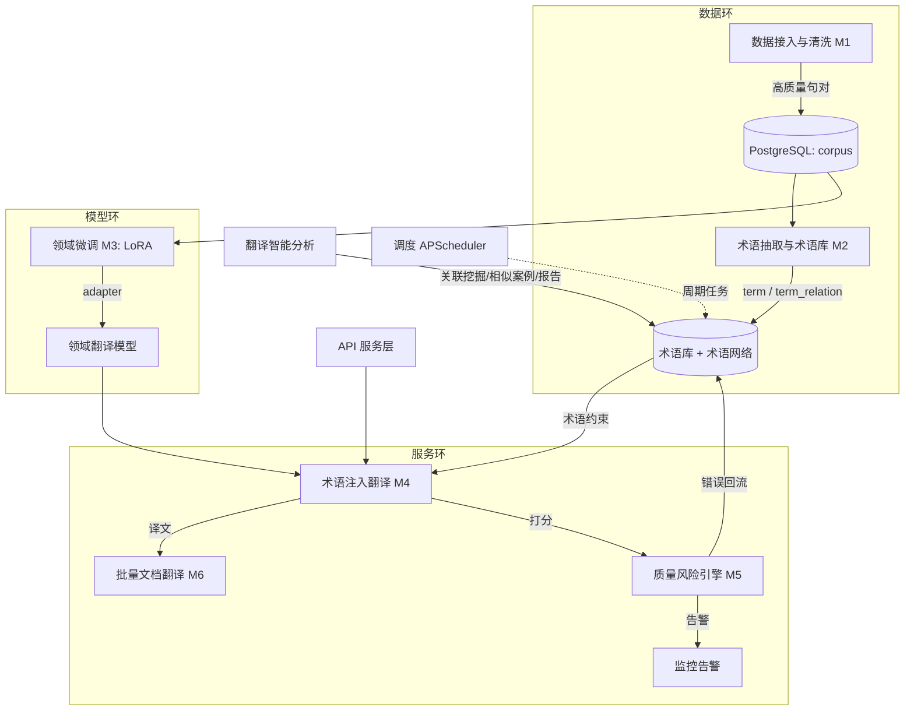
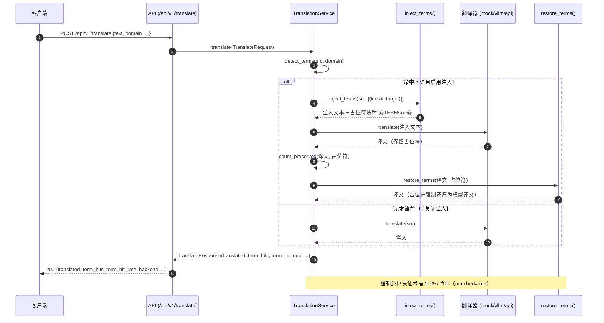
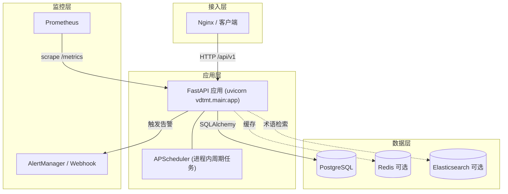
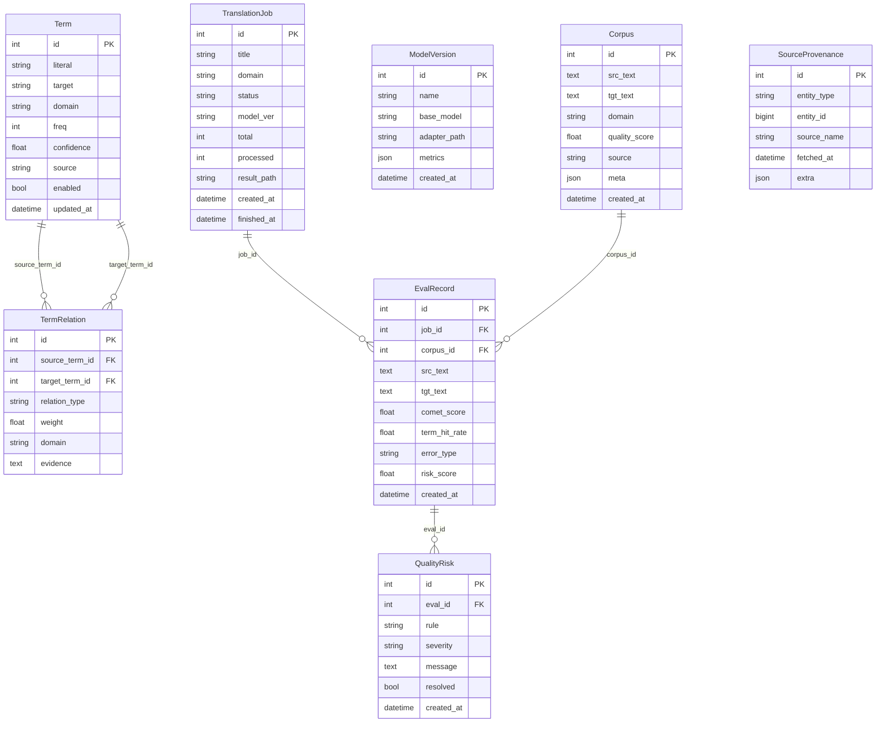

# VDT-MT · 垂直领域专业术语机器翻译引擎

> 企业级垂直领域专业术语机器翻译引擎：语料清洗、术语抽取、LoRA 微调、术语约束翻译、
> 质量风险预警与翻译智能分析。

[](https://github.com/Nephets1010/vertical-domain-translation-engine/actions/workflows/ci.yml)


达到企业级生产标准：配置管理、结构化日志、统一异常、单元测试/集成测试、数据库迁移、容器化部署与 CI 流水线、完整文档。

---

## 1. 架构总览



> 除上方高层架构外，以下补充三张更细粒度的图：翻译管线时序、部署拓扑、核心数据模型 ER。

### 1.1 翻译管线时序图（术语约束：占位符注入 → 翻译 → 强制还原）



### 1.2 部署拓扑图（docker-compose 单机生产）



### 1.3 核心数据模型 ER 图



> 说明：`TermRelation.source_term_id` / `target_term_id` 均外键指向 `Term.id`（级联删除）；`EvalRecord.job_id` 外键指向 `TranslationJob.id`（级联删除）、`corpus_id` 外键指向 `Corpus.id`（置空）；`QualityRisk.eval_id` 外键指向 `EvalRecord.id`（级联删除）。`ModelVersion` 与 `SourceProvenance` 为逻辑/溯源实体（`SourceProvenance` 用 `entity_type`+`entity_id` 泛型关联，非外键约束）。

### 模块与用户需求映射（详见 [ADR-0005](docs/adr/0005-module-remap.md)）

| 用户需求模块 | 翻译引擎实现 | 代码位置 |
|--------------|--------------|----------|
| 数据接入与清洗 | 语料接入与清洗 M1 | `src/vdtmt/corpus/` |
| 图谱构建与存储 | 术语库 + 术语网络 M2 | `src/vdtmt/terminology/` |
| 风险预警规则引擎与评分模型 | 质量风险引擎 M5 | `src/vdtmt/quality/` |
| 图谱可视化检索 | 术语网络可视化检索 | `src/vdtmt/api/routes_viz.py` + `static/` |
| 智能投研分析 | 翻译智能分析（关联挖掘/相似案例/报告） | `src/vdtmt/analytics/` |
| 服务接口层 | FastAPI 服务 | `src/vdtmt/api/` |
| 任务调度与监控告警 | APScheduler + Prometheus + 告警 | `src/vdtmt/scheduler/`, `src/vdtmt/monitoring/` |

---

## 2. 目录结构

```
vertical-domain-translation-engine/
├── src/vdtmt/            # 源码包
│   ├── config.py         # 配置（Pydantic Settings，密钥走环境变量）
│   ├── logging_setup.py  # 结构化日志
│   ├── exceptions.py     # 统一异常体系
│   ├── db/               # 引擎/会话 + SQLAlchemy 模型
│   ├── corpus/           # M1 语料接入与清洗
│   ├── terminology/      # M2 术语抽取与术语库/网络
│   ├── training/         # M3 领域微调管线
│   ├── translation/      # M4 术语注入翻译 + M6 批量
│   ├── quality/          # M5 质量风险引擎与评分
│   ├── analytics/        # 翻译智能分析
│   ├── scheduler/        # 任务调度
│   ├── monitoring/       # 指标 + 告警
│   └── api/              # 服务接口层
├── alembic/              # 数据库迁移
├── tests/                # 单元 + 集成测试
├── sample_data/          # 示例语料与术语表
├── deploy/               # Prometheus 配置
├── docs/adr/             # 架构决策记录
├── Dockerfile            # 多阶段镜像
├── docker-compose.yml    # 单机编排
├── .github/workflows/    # CI
└── pyproject.toml
```

---

## 3. 快速上手

### 3.1 本地运行（无需 GPU / Postgres）

```bash
python -m venv .venv
source .venv/Scripts/activate        # Windows: .venv\Scripts\activate
pip install -e ".[dev]"
cp .env.example .env                  # 默认 mock 翻译器 + SQLite

# 初始化库表（开发用；生产用 alembic upgrade head）
python -c "from vdtmt.db.base import init_db; init_db()"

# 加载示例数据（使用默认样例路径；也可用 --corpus / --terms 覆盖）
python -m vdtmt.tools.seed
# 等价于：
# python -m vdtmt.tools.seed --corpus sample_data/corpus/en_zh_sample.jsonl --terms sample_data/corpus/terms.csv

# 启动服务
uvicorn vdtmt.main:app --port 8000
```

访问：
- API 文档： http://localhost:8000/docs
- 指标： http://localhost:8000/metrics
- 术语网络可视化： http://localhost:8000/viz （静态页面，数据来自 `/api/v1/viz/term-graph`）

### 3.2 Docker Compose（单机生产）

```bash
docker compose up -d --build
# 启动命令内含 alembic upgrade head
```

> 本机无 Docker 守护进程，镜像与编排已提供并在 CI 中校验构建；实际 `docker compose up`
> 请在具备 Docker 的环境执行。

---

## 4. API 概览

| 方法 | 路径 | 说明 |
|------|------|------|
| GET  | `/health` `/ready` | 存活 / 就绪探针 |
| GET  | `/metrics` | Prometheus 指标 |
| GET  | `/api/v1/corpus` | 语料列表 / 计数（`/count`） |
| POST | `/api/v1/corpus` | 新增句对 |
| POST | `/api/v1/corpus/ingest` | 导入文件（JSONL/TSV/CSV 术语/TMX/网页） |
| DELETE | `/api/v1/corpus/{id}` | 删除句对 |
| GET  | `/api/v1/terms` | 术语库列表 / 检索（`/search`） |
| POST | `/api/v1/terms` | 新增术语 |
| POST | `/api/v1/terms/bulk` | 批量导入术语 |
| POST | `/api/v1/terms/extract` | 从语料抽取并入库术语 |
| POST | `/api/v1/terms/relations` | 写入术语关系（轻量图谱） |
| POST | `/api/v1/terms/suggest-network` | 术语网络（图谱）导出 |
| GET  | `/api/v1/terms/{id}/relations` | 术语关联关系 |
| DELETE | `/api/v1/terms/{id}` | 删除术语 |
| POST | `/api/v1/training/prepare` | 离线构建 SFT 数据集 |
| POST | `/api/v1/training/dry-run` | 离线演练（登记版本） |
| POST | `/api/v1/training/run` | 真实 LoRA 微调（需 GPU） |
| GET  | `/api/v1/training/versions` | 模型版本列表 |
| POST | `/api/v1/translate` | 单条术语约束翻译 |
| POST | `/api/v1/translate/batch` | 批量翻译（异步任务） |
| POST | `/api/v1/translate/document` | 整篇文档翻译 |
| GET  | `/api/v1/translate/jobs/{id}` | 翻译任务状态 |
| POST | `/api/v1/eval/evaluate` | 评估并触发风险规则 |
| POST | `/api/v1/eval/feedback` | 错误句对回流（闭环） |
| GET  | `/api/v1/eval/records` `/risks` | 评估记录 / 风险列表 |
| POST | `/api/v1/eval/risks/{id}/resolve` | 处置风险 |
| GET  | `/api/v1/analytics/associations` | 术语关联挖掘 |
| POST | `/api/v1/analytics/similar-cases` | 相似错误案例 |
| GET  | `/api/v1/analytics/report` | 质量报告摘要 |
| GET  | `/api/v1/viz/term-graph` | 术语网络图谱数据 |
| GET  | `/viz` | 术语网络可视化页面（离线） |

详细字段见 [docs/api.md](docs/api.md)。

---

## 5. 测试

```bash
pytest --cov=src            # 单元 + 集成测试（SQLite，离线）
```

---

## 6. 部署与运维

- **迁移**：`alembic upgrade head`（数据库无关，SQLite/PostgreSQL 通用）
- **配置**：全部通过环境变量 / `.env`，敏感信息（DB 口令、API Key、告警令牌）绝不入库
- **监控**：`/metrics` 暴露请求量/延迟/术语命中/风险告警；告警经日志/Webhook/邮件外发
- **调度**：APScheduler 周期刷新指标、术语热更新、领域漂移检测（可配置）

---

## 7. 许可证

[MIT](LICENSE)。欢迎贡献，见 [CONTRIBUTING.md](CONTRIBUTING.md)。

---

## 8. ADR 索引

- [ADR-0001 总体架构与分层](docs/adr/0001-architecture-overview.md)
- [ADR-0002 存储选型](docs/adr/0002-storage-selection.md)
- [ADR-0003 语料接入与清洗策略](docs/adr/0003-corpus-cleaning.md)（模块 M1）
- [ADR-0004 术语抽取与术语网络](docs/adr/0004-terminology-extraction-network.md)（模块 M2）
- [ADR-0005 用户需求模块的翻译引擎重映射](docs/adr/0005-module-remap.md)
- [ADR-0006 领域微调管线](docs/adr/0006-training-pipeline.md)（模块 M3）
